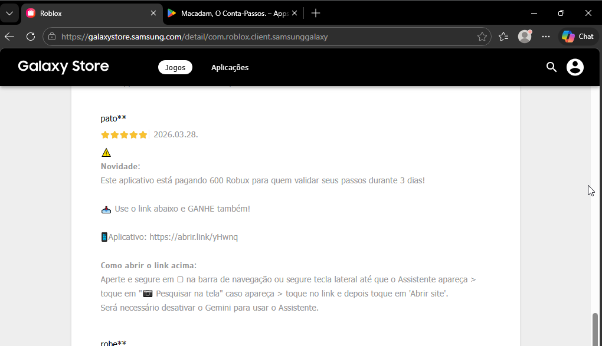

# Relatório de Cyber Threat Intelligence
## Análise de Scam de Robux via Encurtador e CPI

> **Status:** Análise Concluída  
> **Data:** 12/11/2026  
> **Autor:** João P.  
> **Escopo:** Investigação de links promocionais fraudulentos (isca de Robux) e fluxo de redirecionamento

## Resumo Executivo
Esta investigação analisa uma campanha de engenharia social disseminada por meio de comentários em massa na página oficial do jogo Roblox dentro da Samsung Galaxy Store. As mensagens prometem a entrega gratuita de moeda virtual (Robux) mediante o cumprimento de tarefas por três dias e direcionam os usuários a um link encurtado (abrir.link/yHwnq).

A análise técnica da cadeia de redirecionamento demonstrou que o link não conduz a páginas de phishing de credenciais nem a downloads de malware direto, mas sim à página oficial do aplicativo "Macadam, O Conta-Passos" na Google Play Store. A inspeção dos parâmetros da URL de destino revelou o uso do parâmetro referrer contendo identificadores da plataforma de atribuição *Adjust* (adjust_reftag), confirmando que a operação visa a monetização fraudulenta por meio de programas de afiliados baseados em *CPI (*Cost Per Install)**.

**Julgamento principal:** A ameaça não caracteriza comprometimento técnico de dispositivos ou roubo de contas, mas sim uma campanha de fraude publicitária (ad fraud / abuso de afiliados) sustentada por engenharia social voltada ao público infantojuvenil.

**Implicação defensiva:** Usuários não devem confiar em promessas de recompensas digitais publicadas em seções de avaliações de lojas de aplicativos. Moderadores de lojas e plataformas de atribuição devem monitorar picos anômalos de instalação atrelados a identificadores específicos de referência (adjust_reftag) originados de spam em avaliações.

---

## 1. O que está acontecendo? (O Contexto e a Isca)

Ao acessar a página do Roblox na *Samsung Galaxy Store* é possível notar uma enxurrada de avaliações falsas prometendo Robux gratuitos após uma validação de passos durante 3 dias. 



O golpe explora gatilhos clássicos de engenharia social voltados principalmente para crianças e adolescentes sem renda própria:
* *Curiosidade:* Instiga a dúvida "será que funciona mesmo?".
* *Urgência e Novidade:* "Este aplicativo está pagando X Robux para quem validar seus passos durante 3 dias! Use o link abaixo e GANHE também!"
* *Recompensa Fácil:* Promessa de obter moeda digital sem custo financeiro## Lure

---

## 2. Como eu analisei? (Cadeia de Redirecionamento)

Ao inspecionar a URL divulgada nos comentários (hxxps://abrir[.]link/yHwnq), observei que o operador escolheu um encurtador de URLs legítimo e amplamente conhecido no Brasil (abrir.link). Isso reduz a desconfiança inicial da vítima e mascara o destino final.

*Fluxo observado:*
```text
Comentário na Galaxy Store ──▶️ abrir.link/yHwnq ──▶️ Google Play Store ("Macadam, O Conta-Passos")
```

---

## Comportamento técnico durante o acesso:

* Redirecionamento direto para a página oficial do aplicativo na Google Play Store.

* Nenhum download automático de APK externo.

* Nenhuma execução de script malicioso ou solicitação de permissão invasiva no navegador.

(Nota: Não foram observados saltos intermediários visíveis no navegador, embora redirecionamentos rápidos no lado do servidor não possam ser descartados sem captura completa de cabeçalhos HTTP).

---

## 3. O que eu descobri? (Tracking e Monetização)
Se o link não rouba a senha do Roblox nem instala vírus, como o golpista ganha dinheiro?

A resposta está nos parâmetros da URL de destino da Google Play Store. Foi identificado o parâmetro `referrer` contendo a tag `adjust_reftag`, pertencente à **Adjust** (uma das principais plataformas de atribuição e análise de marketing mobile do mercado).

Isso comprova o modelo de negócio por trás do spam:

1. O operador atua como afiliado ou utiliza uma rede de tráfego incentivado.
2. Cada instalação concluída a partir daquele link específico é contabilizada pela Adjust por meio do identificador `cfhCtHAOhvjls`.
3. O golpista recebe comissões financeiras por cada instalação gerada (CPI — Cost Per Install), enquanto a vítima nunca recebe os Robux prometidos.

---

## 4. Indicadores de Comprometimento e Rastreamento (IOCs)
*Nota: As URLs abaixo foram desarmadas (hxxps / [.]) por segurança para evitar acesso acidental.*

* URL da Isca: hxxps://abrir[.]link/yHwnq

* Domínio Encurtador: abrir[.]link

* Identificador de Atribuição (Adjust): adjust_reftag=cfhCtHAOhvjls

* Aplicativo de Destino: "Macadam, O Conta-Passos" (Google Play Store)

* Padrão de Tática: Spam em avaliações da Galaxy Store com promessa de recompensa em Robux.

---

## 5. Lições Defensivas
* **Para jogadores e responsáveis:** O Roblox não distribui Robux por meio de aplicativos terceiros de contagem de passos nem por links deixados em comentários de lojas. Desconfie de qualquer promessa de moeda grátis fora dos canais oficiais.

* **Para equipes de Trust & Safety / Plataformas:** O bloqueio isolado do encurtador `abrir.link` é ineficaz, pois trata-se de um serviço legítimo. O bloqueio e a investigação devem focar na moderação automatizada de links em avaliações da Galaxy Store e na denúncia do ID de afiliado (`cfhCtHAOhvjls`) junto à rede de atribuição (Adjust) por violação de políticas de tráfego incentivado/enganoso.

---

## Executive Summary
This investigation analyzes a social engineering campaign disseminated through mass comments on the official Roblox game page within the Samsung Galaxy Store. The messages promise the free delivery of virtual currency (Robux) upon completion of tasks for three days and direct users to a shortened link (open.link/yHwnq).

Technical analysis of the redirect chain demonstrated that the link does not lead to credential phishing pages or direct malware downloads, but rather to the official page of the "Macadam, The Step Counter" application on the Google Play Store. Inspection of the destination URL parameters revealed the use of the referrer parameter containing identifiers from the attribution platform *Adjust* (adjust_reftag), confirming that the operation aims at fraudulent monetization through affiliate programs based on **CPI (*Cost Per Install*)**.

**Main finding:** The threat does not involve technical compromise of devices or account theft, but rather an advertising fraud campaign (ad fraud/affiliate abuse) sustained by social engineering targeting children and teenagers.

**Defensive implication:** Users should not trust promises of digital rewards published in app store review sections. App store moderators and attribution platforms should monitor anomalous installation spikes linked to specific referral identifiers (adjust_reftag) originating from spam in reviews.
